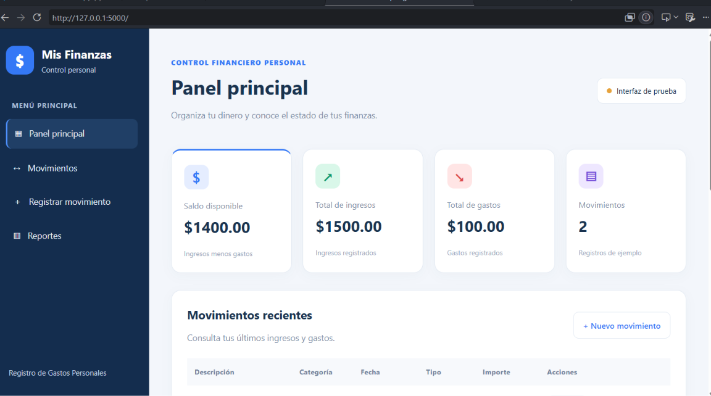
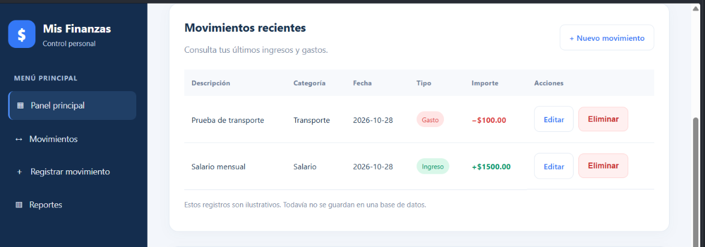
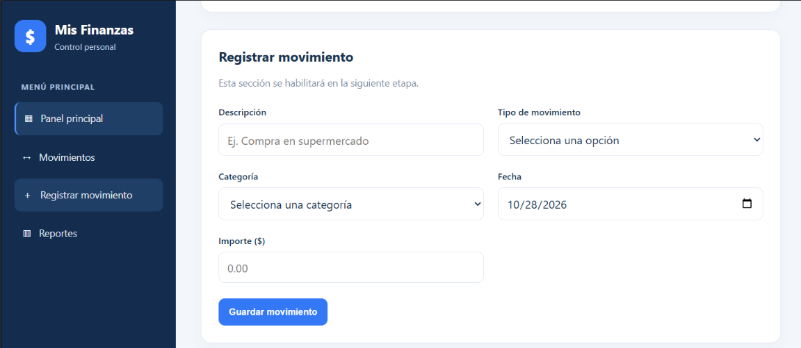
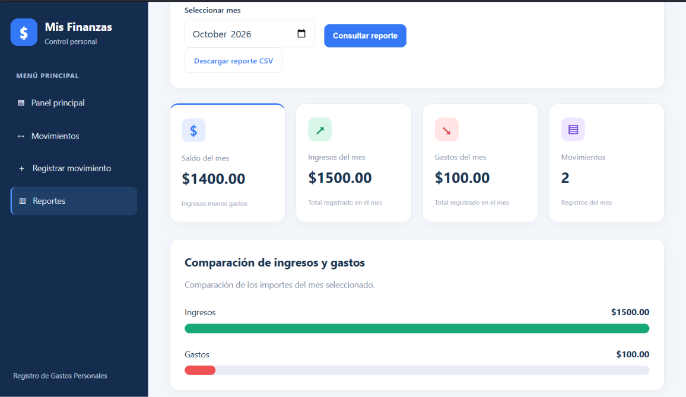
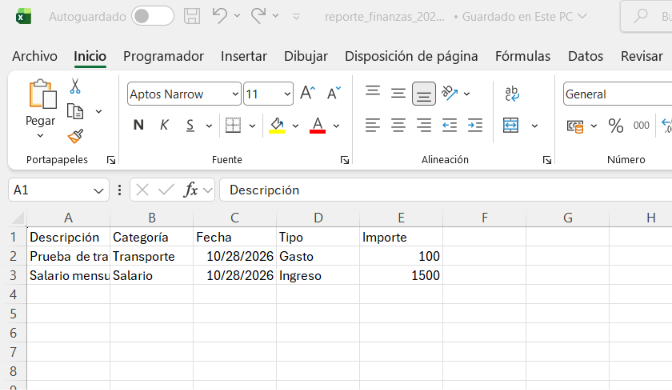

# Mis Finanzas — Registro de Gastos Personales

Proyecto académico desarrollado en Python para la asignatura Sistemas Colaborativos de la Universidad Tecnológica de Panamá. Forma parte de un portafolio profesional digital orientado al desarrollo de soluciones informáticas.

## 1. Descripción del proyecto

Mis Finanzas es una aplicación web para registrar y consultar ingresos y gastos personales. Permite organizar los movimientos por categorías, calcular el saldo disponible y consultar reportes mensuales.

La aplicación utiliza Flask para gestionar las solicitudes web y SQLite para conservar los movimientos registrados. Su interfaz está desarrollada con HTML y CSS, con un diseño de azul oscuro y blanco.

## 2. Problema que resuelve

La aplicación facilita el seguimiento de los ingresos y gastos personales mediante un registro organizado de los movimientos. Permite conocer la diferencia entre los ingresos y los gastos, consultar la actividad de un mes y exportar los datos para analizarlos en una hoja de cálculo.

## 3. Objetivos

### Objetivo general

Desarrollar una aplicación web que permita administrar ingresos y gastos personales, almacenar los movimientos en una base de datos y consultar resúmenes financieros mensuales.

### Objetivos específicos

- Registrar ingresos y gastos con descripción, categoría, fecha e importe.
- Consultar los movimientos registrados.
- Editar y eliminar movimientos.
- Calcular los ingresos, los gastos y el saldo disponible.
- Consultar reportes por mes.
- Visualizar una comparación de ingresos y gastos.
- Exportar los movimientos mensuales a un archivo CSV compatible con Excel.

## 4. Tecnologías utilizadas

- **Python:** lenguaje de programación.
- **Flask:** framework para desarrollar la aplicación web.
- **SQLite:** base de datos relacional.
- **HTML5:** estructura de las páginas.
- **CSS3:** diseño visual adaptable.
- **Visual Studio Code:** entorno de desarrollo.
- **Git y GitHub:** herramientas previstas para el control de versiones y la publicación del proyecto.

## 5. Funcionalidades implementadas

### Panel principal

- Mostrar los ingresos registrados.
- Mostrar los gastos registrados.
- Calcular el saldo disponible.
- Contar los movimientos almacenados.

### Gestión de movimientos

- Registrar ingresos y gastos.
- Seleccionar una categoría y una fecha.
- Editar los datos de un movimiento.
- Eliminar movimientos mediante una confirmación.
- Rechazar descripciones vacías, campos obligatorios incompletos e importes iguales o inferiores a cero.

### Reportes mensuales

- Filtrar los movimientos por mes.
- Calcular ingresos, gastos y saldo del periodo.
- Agrupar los gastos por categoría.
- Mostrar un gráfico comparativo de ingresos y gastos.
- Exportar los movimientos del mes a CSV para su apertura en Excel.

## 6. Estructura del proyecto

La estructura de archivos prevista es la siguiente:

```text
Registro_Gastos_Personales/
├── app.py
├── README.md
├── finanzas.db
├── static/
│   └── style.css
├── templates/
│   ├── index.html
│   ├── editar_movimiento.html
│   └── reportes.html
└── capturas/
    ├── 01-panel-principal.png
    ├── 02-movimientos.png
    ├── 03-registro.png
    ├── 04-reportes-mensuales.png
    └── 05-exportacion-excel.png
```

La estructura real debe verificarse antes de publicar el repositorio. El archivo `finanzas.db` contiene datos de la aplicación local y no debe incluirse en un repositorio público si contiene información personal.

## 7. Requisitos

- Python 3 instalado.
- Flask instalado.
- Visual Studio Code u otro editor.
- Un navegador web actualizado.
- Los archivos del proyecto.

SQLite forma parte de la biblioteca estándar de Python y no requiere instalar un servidor de base de datos independiente.

## 8. Instalación y ejecución

### 8.1. Obtener el proyecto

Descargar o clonar el repositorio y abrir la carpeta del proyecto en Visual Studio Code.

### 8.2. Instalar Flask

Abrir una terminal en la carpeta del proyecto y ejecutar:

```bash
python -m pip install flask
```

### 8.3. Ejecutar la aplicación

Ejecutar el siguiente comando en la terminal:

```bash
python app.py
```

Cuando Flask indique que el servidor está activo, abrir el navegador y visitar:

```text
http://127.0.0.1:5000
```

La terminal debe permanecer abierta mientras se utiliza la aplicación localmente.

## 9. Base de datos

La aplicación utiliza SQLite para almacenar los movimientos. Cada registro contiene un identificador, descripción, categoría, fecha, tipo de movimiento e importe.

La base de datos permite conservar los registros entre ejecuciones del programa. Los totales y reportes se calculan a partir de los movimientos almacenados.

## 10. Pruebas funcionales realizadas

Durante el desarrollo local se realizaron pruebas manuales de las siguientes funciones:

- Registro de ingresos y gastos.
- Actualización de los indicadores financieros.
- Conservación de los movimientos después de reiniciar Flask.
- Edición de movimientos.
- Eliminación de movimientos.
- Consulta de reportes mensuales.
- Comparación visual de ingresos y gastos.
- Exportación de movimientos a CSV y comprobación del archivo en Excel.
- Rechazo de descripciones vacías, importes iguales a cero, importes negativos y campos obligatorios incompletos.
- Navegación entre las principales secciones de la aplicación.

Estas comprobaciones corresponden a pruebas manuales realizadas durante el desarrollo; no equivalen a una certificación integral ni a una suite de pruebas automatizadas.

## 11. Evidencias visuales

Las siguientes capturas documentan las principales funciones de la aplicación y las pruebas realizadas durante el desarrollo.

### Panel principal

Muestra los indicadores de ingresos, gastos, saldo disponible y cantidad de movimientos.



### Gestión de movimientos

Presenta el listado de los movimientos registrados.



### Registro de movimientos

Muestra el formulario utilizado para registrar ingresos y gastos.



### Reportes mensuales

Presenta los resultados del periodo seleccionado y el gráfico comparativo de ingresos y gastos.



### Exportación a Excel

Evidencia el archivo CSV exportado y su apertura en Excel.



## 12. Seguridad y limitaciones

La aplicación se ha desarrollado con fines académicos y se ejecuta localmente. Antes de utilizarla en un entorno real, se deben revisar la configuración de seguridad de Flask, la gestión de claves secretas, la protección de formularios, el manejo de errores y las condiciones de despliegue.

El servidor de desarrollo de Flask no está destinado a producción. También se recomienda añadir pruebas automatizadas y revisar el manejo de importes monetarios antes de considerar terminada una versión definitiva.

## 13. Estado del proyecto

**Estado: en desarrollo, con funcionalidades principales probadas manualmente.**

La aplicación permite registrar, consultar, editar y eliminar movimientos; calcular indicadores financieros; consultar reportes mensuales y exportar movimientos a CSV. Queda pendiente una revisión integral del código, la verificación de la estructura real del repositorio, la configuración de seguridad y la publicación documentada en GitHub.

## 14. Autor

**Bernabé Quijada Abrego**

Estudiante de la Universidad Tecnológica de Panamá.

Proyecto académico de la asignatura Sistemas Colaborativos.
